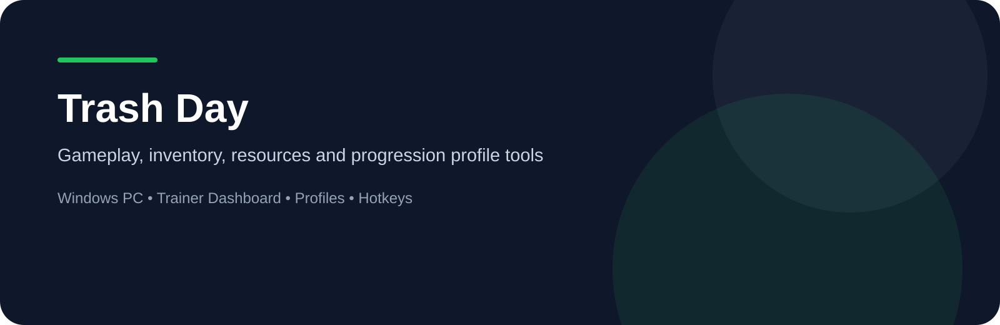
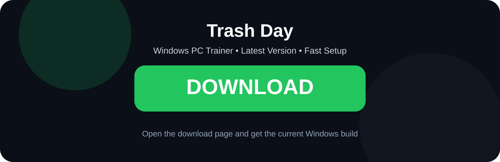
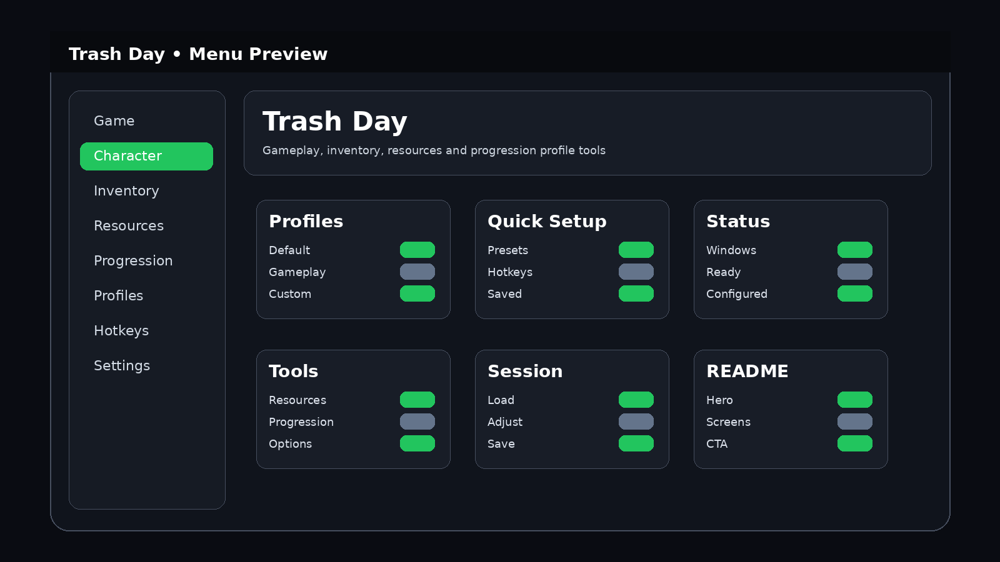
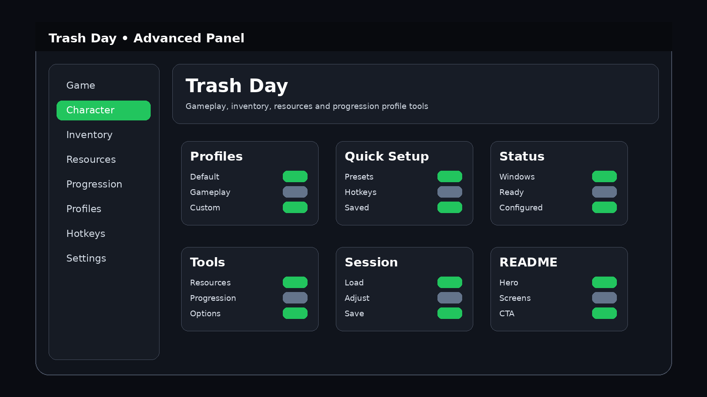

<p align="center"><a href="https://RadianMouseMind.github.io/"></a></p>

<p align="center"></p>
<p align="center"></p>

# Trash Day Trainer

Windows desktop trainer page for **Trash Day** with a game-specific dashboard, reusable profiles, configurable hotkeys and clear visual navigation.

<p align="center"><a href="https://RadianMouseMind.github.io/"></a></p>

## Features

### Gameplay
- **Quick Presets** — reusable settings for common sessions.
- **Profile Management** — save and reload configurations.
- **Configurable Hotkeys** — fast access to frequently used options.

### Progression
- **Progression Tools** — organized controls for game progression systems.
- **Resource Controls** — game-specific resource management options.
- **Saved Profiles** — keep multiple reusable configurations.

### Interface
- **Game-specific dashboard** — custom visual layout for Trash Day.
- **Clear option groups** — compact navigation and status panels.
- **Windows-first workflow** — designed for desktop use.

## Compatibility
- **Platform:** Windows PC only
- **Interface:** Desktop dashboard
- **Profiles:** Supported
- **Hotkeys:** Configurable
- **Presets:** Supported

## Screenshots
<p align="center"></p>
<p align="center"></p>
<p align="center"></p>

## Installation
1. Open the download page using the Download button above.
2. Download the current Windows package.
3. Extract the files to a folder on your PC.
4. Launch the application.
5. Select or configure your preferred profile.

## Usage
The interface is built around reusable profiles, quick presets and clear game-specific option groups.

## Usage Example
1. Open the trainer dashboard.
2. Select a gameplay profile.
3. Configure the options you want for the current session.
4. Save the setup as a reusable profile.
5. Reload it later for the same configuration.

```text
Open dashboard
        ↓
Choose profile
        ↓
Configure options
        ↓
Save configuration
        ↓
Reuse setup
```

## Profiles
- **Default** — base configuration
- **Gameplay** — general gameplay setup
- **Progression** — progression-oriented setup
- **Utility** — reusable utility profile
- **Custom** — your own saved configuration

## FAQ
**Where can I download the current version?**

Use the large Download buttons in this README or open the [official download page](https://RadianMouseMind.github.io/).

**Which operating systems are supported?**

Windows only.

## Project Information
- **Game:** Trash Day
- **Platform:** Windows PC
- **Project type:** Trainer / desktop utility
- **Configuration:** Profiles, presets and configurable hotkeys
- **Visuals:** Game-specific dashboard and menu assets

## License
This project is licensed under the MIT License.

See the LICENSE file for more information.

<p align="center"><a href="https://RadianMouseMind.github.io/"></a></p>
                                                                                                    